# V3 architecture

Five composition roots create separate Graffiti clients and independently branded apps. Public event discovery and venue community reading use separate services and channels. OurScene reads venue/event records and constructs cross-app links; it does not retrieve community posts.

## Responsibility boundaries

| Layer | Responsibilities |
| --- | --- |
| Domain | Venue/event validation, genres, schedules, actual authorship, immutable content references, username normalization/conflicts, ancestry, moderation and deletion projection |
| Application | Publishing workflows, feed retrieval coordination, shared filters, community lifecycle and permissions through narrow reader/writer/identity ports |
| Infrastructure | Official Graffiti clients, session events/account preference, schemas, channels, cursors/tombstones, stale reconciliation, app URL resolution and sandbox seeding |
| Presentation | Public Events/Community, role-gated owner desk, accessible forms, nested thread rendering, map/list/details and bundled demo assets |
| Composition | Inject services, adapters, navigation function, branding and event snapshots; own cleanup |

`EventExplorerState` is the single filter projection for map, list, counts and location thumbnails. `CommunityService` receives event snapshots for tagging and discovers community/username records independently. Pure domain functions resolve claims and build threads. The venue view presents operator forms only to the configured owner; services independently enforce permissions.

## Contracts and data flow

Profiles add optional HTTPS `appUrl`; events add optional shared `genres` and sandbox `demoArtworkKey`. Existing version-1 records remain valid. Event identity remains venue actor + stable event ID across immutable revisions. A discussion URL is an injected presentation capability that uses discovered profile data; no presentation component imports Graffiti or its session/cursor types.

New records use version 1 and UTC epoch milliseconds. `UsernameClaim` is actor-authored with username and publication time. `CommunityPost` has stable content ID, venue actor, text, optional HTTPS image and optional venue-scoped event ID. `CommunityReply` adds root and parent author/ID references. `CommunityRemoval` is authored by the content author and retains only structural references, original publication time and optional event ID. `CommunityModeration` is authored by the venue, targeting an author/ID with a hide/restore flag. Graffiti metadata supplies all authors; a channel or claimed field is never evidence of ownership.

Channels are `music-venues:v1:usernames` and `music-venues:v1:community:<encoded venue actor>`, alongside existing directory, event and legacy channels. Every adapter uses the existing `GraffitiObservation` lifecycle for initial discovery, visible-page polling, refresh coalescing, cursor recovery, tombstones, partial failure retention and cleanup.

One latest username claim per actor is selected by published time and smallest URL at a tie; the smallest URL among active claims wins each normalized name. No atomic central reservation exists. Community IDs are immutable and deduplicate by actor/ID using the smallest source URL. Removal is terminal for that author/ID. Moderation resolves by newest publication time and largest URL at a tie; descendants inherit hidden state. Restoration does not override a separately hidden descendant. Invalid or cyclic ancestry is excluded with diagnostics.

Author deletion publishes a content-free marker before attempting source cleanup. Surviving replies retain placeholders; event collection metadata survives. Moderation is a venue presentation decision, not deletion of other authors’ public objects. Actor IDs stay out of rendered UI but remain part of public Graffiti data. These limitations are disclosed at username setup.

## GRASP and SOLID

| Principle | V3 implementation |
| --- | --- |
| Information Expert / Creator | Domain models validate their records; application services create records from authenticated sessions and inputs. |
| Controller / High Cohesion | Event controllers coordinate workflows; CommunityService coordinates community use cases; views own DOM rendering. |
| Low Coupling / Indirection | Narrow ports isolate Graffiti, identity events, discovery and navigation. Domain and application code have no DOM or SDK dependency. |
| Polymorphism / Protected Variations | Replace FeedView, map adapter, identity or repositories through composition. Optional versioned fields preserve existing record compatibility. |
| Pure Fabrication | Feed store, observation adapter and repositories handle persistence and synchronization outside entities. |
| Single Responsibility | Filtering, scheduling, naming, thread projection, persistence, map rendering and UI each have focused responsibilities. |
| Open/Closed / Dependency Inversion | New presentation and storage implementations plug into application-defined contracts without changing domain rules. |
| Liskov Substitution / Interface Segregation | Readers preserve asynchronous delivery, lifecycle cleanup and source-health semantics; username, content, identity and event capabilities are separate. |

## Class diagram

```mermaid
classDiagram
 direction TB
 class VenueAppController
 class VenuePublishingService
 class EventPublishingService
 class CommunityView
 class CommunityService
 class SessionIdentityPort {
  <<interface>>
  +loginVisitor()
  +loginOwner()
  +selectSession(actor)
 }
 class CommunityReader {
  <<interface>>
  +observeCommunity(venueActor, listener)
 }
 class CommunityWriter {
  <<interface>>
  +publish(value, session)
  +remove(record, marker, session)
 }
 class UsernameReader {
  <<interface>>
  +observeUsernames(listener)
 }
 class UsernameWriter {
  <<interface>>
  +claim(value, session)
 }
 class UsernameClaim
 class CommunityRecord
 class CommunityProjection {
  +posts: ThreadNode[]
  +diagnostics: string[]
 }
 class ThreadNode {
  +ref: ContentRef
  +removed: boolean
  +hidden: boolean
  +children: ThreadNode[]
 }
 class AggregatorController
 class FeedService
 class FeedStore
 class EventExplorerState {
  +setFilters(change)
  +project()
 }
 class EventExplorerView
 class FeedView {
  <<interface>>
  +render(snapshot)
  +dispose()
 }
 class EventMapAdapter {
  <<interface>>
 }
 class LeafletMapAdapter
 class EventDetailView
 class VenueProfile {
  +appUrl: HTTPS URL
  +address: string
  +location: GeoPoint
 }
 class MusicEvent {
  +eventId: string
  +genres: Genre[]
  +tickets: TicketInput
 }
 class GraffitiCommunityRepository
 class GraffitiIdentityAdapter
 class GraffitiObservation
 class GraffitiEventRepository
 class DiscussionNavigation
 class GraffitiClient {
  <<external>>
 }
 VenueAppController --> VenuePublishingService
 VenueAppController --> EventPublishingService
 CommunityView --> CommunityService
 CommunityView --> SessionIdentityPort
 CommunityService --> CommunityReader
 CommunityService --> CommunityWriter
 CommunityService --> UsernameReader
 CommunityService --> UsernameWriter
 CommunityService --> CommunityProjection : domain projection
 CommunityService --> UsernameClaim : domain claim resolution
 CommunityProjection o-- ThreadNode
 ThreadNode o-- CommunityRecord
 CommunityView ..> FeedStore : event snapshots via composition
 GraffitiIdentityAdapter ..|> SessionIdentityPort
 GraffitiCommunityRepository ..|> CommunityReader
 GraffitiCommunityRepository ..|> CommunityWriter
 GraffitiCommunityRepository ..|> UsernameReader
 GraffitiCommunityRepository ..|> UsernameWriter
 GraffitiCommunityRepository --> GraffitiObservation
 GraffitiCommunityRepository --> GraffitiClient
 GraffitiIdentityAdapter --> GraffitiClient
 GraffitiEventRepository --> GraffitiObservation
 AggregatorController --> FeedService
 AggregatorController --> FeedStore
 AggregatorController --> FeedView
 EventExplorerView ..|> FeedView
 EventExplorerView --> EventExplorerState
 EventExplorerView --> EventDetailView
 EventExplorerView --> EventMapAdapter
 LeafletMapAdapter ..|> EventMapAdapter
 EventDetailView ..> DiscussionNavigation : injected URL function
 DiscussionNavigation --> VenueProfile : discovered app URL
 DiscussionNavigation --> MusicEvent : stable event ID
 FeedService --> GraffitiEventRepository : EventReader port
 FeedService --> FeedStore
 FeedStore o-- MusicEvent
 FeedStore o-- VenueProfile
 EventPublishingService --> GraffitiEventRepository : EventWriter port
```



## Sequence diagram

```mermaid
sequenceDiagram
 actor Visitor
 participant OurScene
 participant Filter as EventExplorerState
 participant Detail as Event details
 participant Venue as Venue community UI
 participant Identity as Identity adapter
 participant Service as CommunityService
 participant Domain as Claim / thread rules
 participant Repo as Graffiti adapters
 participant G as Shared Graffiti
 actor Owner
 Visitor->>OurScene: Choose dates, genres and price
 OurScene->>Filter: setFilters(change)
 Filter-->>OurScene: Shared list / pin / thumbnail projection
 Visitor->>Detail: Open event
 Detail-->>Visitor: Address, schedule, artwork and conversation link
 Visitor->>Venue: Follow discovered appUrl + stable event ID
 Venue->>Service: Start venue and username observations
 Service->>Repo: observeCommunity(), observeUsernames()
 Repo->>G: Discover channels
 G-->>Repo: Records, cursor and source warnings
 Repo-->>Service: Domain records and source health
 Service->>Domain: Resolve names and nested thread ancestry
 Domain-->>Venue: Event collection, public authors, threads
 Visitor->>Identity: Visitor sign in / select restored account
 Identity-->>Venue: Session state, no rendered actor IDs
 opt No winning username
  Visitor->>Service: Choose username
  Service->>Repo: Refresh username discovery
  Repo-->>Service: Complete discovery or stale warning
  Service->>Domain: Normalize and check current claims
  alt Complete discovery and name available
   Service->>Repo: Publish UsernameClaim
   Repo->>G: post(claim, session)
   Service->>Domain: Reconcile deterministic conflicts
  else Stale discovery / taken name
   Service-->>Visitor: Retry or choose another name
  end
 end
 Visitor->>Service: Publish post with optional event tag / HTTPS photo
 Service->>Domain: Validate name, content and venue event
 Service->>Repo: publish(record, author session)
 Repo->>G: post to venue community channel
 Service-->>Venue: Refresh and render immediately
 Visitor->>Service: Reply to post or reply
 Service->>Domain: Validate root and parent ancestry
 Service->>Repo: Publish reply with root and parent refs
 Owner->>Identity: Venue owner sign in
 Owner->>Service: Hide / restore subtree
 Service->>Repo: Publish venue-authored moderation
 Repo->>G: post(moderation, owner session)
 Service->>Domain: Verify actual author is venue owner
 Domain-->>Venue: Visitors omit subtree; owner may restore
 Visitor->>Service: Delete own post / reply
 Service->>Repo: Publish terminal author-removal marker
 Repo->>G: post structural removal, then delete content object
 Repo-->>Service: Cleanup warnings if any
 Service->>Domain: Preserve content-free ancestors with surviving replies
 loop Every 30 seconds while visible / manual refresh
  Repo->>G: continueDiscover(cursor)
  G-->>Repo: Changes, tombstones and next cursor
  Repo-->>Service: Reconciled records, retained cache and source health
  Service-->>Venue: Updated names and conversation
 end
 Note over Repo,G: Expired cursor: fresh reconciliation. Failure: preserve cache and mark stale.
 Note over OurScene,Venue: OurScene never subscribes to community feeds. It links to the venue app.
```

See [setup](setup-guide.md), [release notes](v3-release-notes.md), and the [README](../README.md) for operational details and boundaries.
